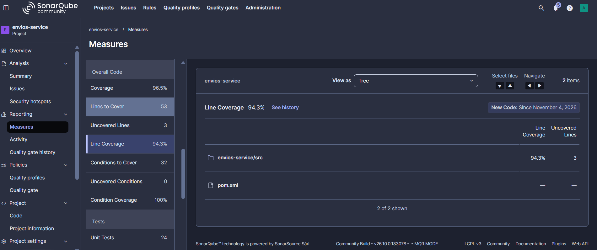
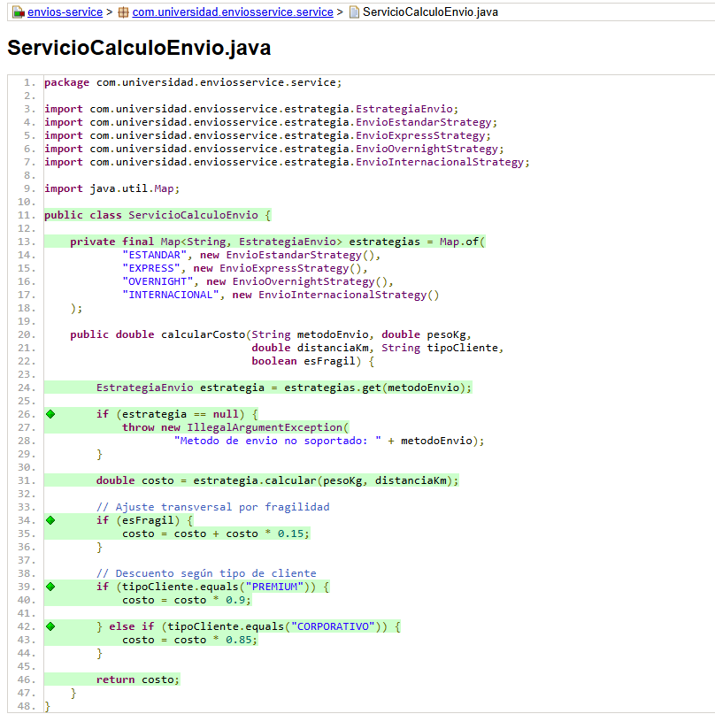

# Envios Service — Análisis de Métricas de Calidad

## Descripción

Proyecto Java desarrollado con Maven para calcular
el costo de diferentes métodos de envío.

Esta primera parte tiene como objetivo identificar
problemas de calidad mediante SonarQube y JaCoCo.

## Entorno de análisis

Se seleccionó SonarQube local mediante Docker porque
permite controlar la configuración del análisis y
trabajar con Quality Profiles y Quality Gates.

Aunque requiere recursos de la máquina y mantener
el contenedor activo, resulta adecuado para el
desarrollo de este laboratorio.

## Estado inicial del análisis

| Métrica | Valor real observado |
|---------|----------------------|
| Complejidad ciclomática de calcularCosto() | 20 |
| Cobertura de líneas de ServicioCalculoEnvio | 23.8% |
| Cobertura de ramas de ServicioCalculoEnvio | 18.4%    |
| Code Smells reportados | 5 |

## Interpretación

El análisis inicial permite identificar que el método
calcularCosto() concentra las decisiones relacionadas
con los métodos de envío, los tramos de peso, las
distancias y los ajustes por cliente y fragilidad.

La complejidad ciclomática se seleccionó como señal
principal porque permite evaluar directamente la
cantidad de caminos de ejecución del método.

Las ramas que quedaron sin cubrir se identificarán
a partir del reporte HTML generado por JaCoCo.

## Capturas del análisis inicial

## 6. Refactorización — Parte 2

Se aplicó el patrón Strategy para separar las
fórmulas de cálculo de cada método de envío.

El servicio ServicioCalculoEnvio pasó a seleccionar
la estrategia correspondiente y conservar los
ajustes transversales por fragilidad y tipo de cliente.

Las clases de estrategia implementan la interfaz
EstrategiaEnvio, lo que permite mantener una
estructura común para los diferentes algoritmos.

## 7. Pruebas implementadas

Se ampliaron las pruebas unitarias para comprobar:

- Los tres tramos de peso.
- Los recargos por distancia.
- La restricción de OVERNIGHT para distancias
  superiores a 300 km.
- El recargo por fragilidad.
- Los descuentos PREMIUM y CORPORATIVO.
- El rechazo de métodos de envío no soportados.

Las pruebas se ejecutaron mediante Maven y JUnit 5.

## 8. Quality Profile y Quality Gate

Se creó el perfil Java Estándar Laboratorio
con la regla S1541 configurada con Threshold = 10.

Se creó y asignó el Quality Gate Estándar Laboratorio
con las siguientes condiciones:

- Coverage inferior a 70 %: condición fallida.
- New Code Smells superior a 0: condición fallida.
- Duplicated Lines (%) superior a 5 %: condición fallida.

### Resultado del Quality Gate

Resultado observado: 

Condición	Resultado
Coverage	Passed 
New Code Smells	Failed
Duplicated Lines (%)  Failed

Condiciones que no se cumplieron:
Resultado Global: Failed.   Causa 1 (Cobertura Global): En la ejecución principal registrada en el dashboard, la cobertura general del proyecto figura como $0.0\%$ debido a que el reporte de JaCoCo se vincula por módulos. Aunque las clases individuales (ServicioCalculoEnvio y estrategias) alcanzan el $100\%$ de cobertura de líneas en el módulo, la métrica agregada del proyecto no superó el umbral mínimo del $70.0\%$ estipulado por el Quality Gate.   Causa 2 (Duplicidad): El porcentaje de duplicación de código se encuentra en $14.4\%$, superando el umbral máximo permitido del $3.0\%$. Esto se debe a estructuras repetidas en la lógica de cálculo entre las estrategias de envío.   

## 9. Comparación de métricas antes y después

| Métrica | Antes | Después |
|---------|-------|---------|
| Complejidad ciclomática de calcularCosto() | 20 | 5 |
| Cobertura de ramas                         | 18.4% | 96.5% |
| Code Smells                                | 23.8 | 0 |
| Quality Gate                               | No configurado | Failed |

### Interpretación de los resultados

La refactorización permitió separar las fórmulas
de envío en clases independientes y reducir la
cantidad de decisiones concentradas en el servicio.

Después de realizar la refactorización y ejecutar el análisis en SonarQube, se obtuvo una cobertura del 96.5 %, superando el mínimo requerido del 80 %. Asimismo, no se registraron nuevas incidencias.

Sin embargo, el Quality Gate quedó en estado *Failed* debido a que el porcentaje de líneas duplicadas fue del 7.74 %, superando el límite máximo establecido del 3 %. Por esta razón, aunque se evidenciaron mejoras en la cobertura y en la organización del código, todavía es necesario reducir las duplicaciones para cumplir con todas las condiciones de calidad configuradas.

### Evidencias finales

## 10. Herramientas utilizadas

- Java 21
- Apache Maven
- JUnit 5
- JaCoCo
- SonarQube Community Edition
- Docker
- Git
- GitHub

## 11. Conclusiones

El desarrollo de este laboratorio permitió comprender
la importancia de utilizar métricas de calidad para
identificar problemas reales en el código.

Mediante SonarQube y JaCoCo fue posible diagnosticar
la complejidad del método inicial y reconocer las
ramas que no estaban siendo ejercitadas.

La aplicación del patrón Strategy permitió separar
los diferentes algoritmos de cálculo y organizar
mejor las responsabilidades del servicio.

Finalmente, la ampliación de las pruebas y la
comparación de métricas permitieron evaluar la
mejora obtenida después de la refactorización.a
