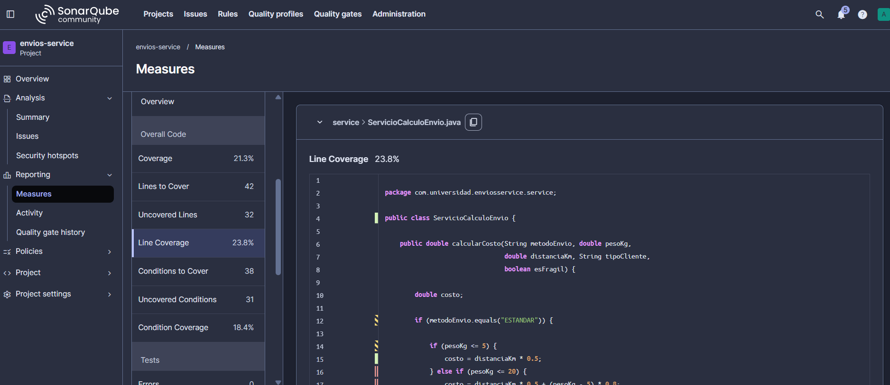
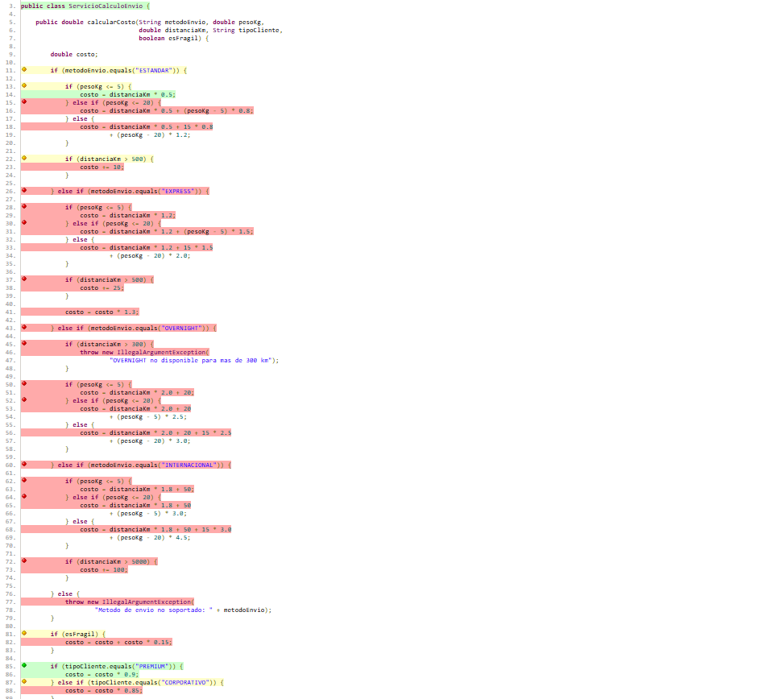

# Envios Service — Análisis de Métricas de Calidad

## Descripción

Proyecto Java desarrollado con Maven para calcular
el costo de diferentes métodos de envío.

Esta primera parte tiene como objetivo identificar
problemas de calidad mediante SonarQube y JaCoCo.

## Entorno de análisis

Se seleccionó SonarQube local mediante Docker porque
permite controlar la configuración del análisis y
trabajar con Quality Profiles y Quality Gates.

Aunque requiere recursos de la máquina y mantener
el contenedor activo, resulta adecuado para el
desarrollo de este laboratorio.

## Estado inicial del análisis

| Métrica | Valor real observado |
|---------|----------------------|
| Complejidad ciclomática de calcularCosto() | 20 |
| Cobertura de líneas de ServicioCalculoEnvio | 23.8% |
| Cobertura de ramas de ServicioCalculoEnvio | 18.4%    |
| Code Smells reportados | 5 |

## Interpretación

El análisis inicial permite identificar que el método
calcularCosto() concentra las decisiones relacionadas
con los métodos de envío, los tramos de peso, las
distancias y los ajustes por cliente y fragilidad.

La complejidad ciclomática se seleccionó como señal
principal porque permite evaluar directamente la
cantidad de caminos de ejecución del método.

Las ramas que quedaron sin cubrir se identificarán
a partir del reporte HTML generado por JaCoCo.

## Capturas del análisis inicial

